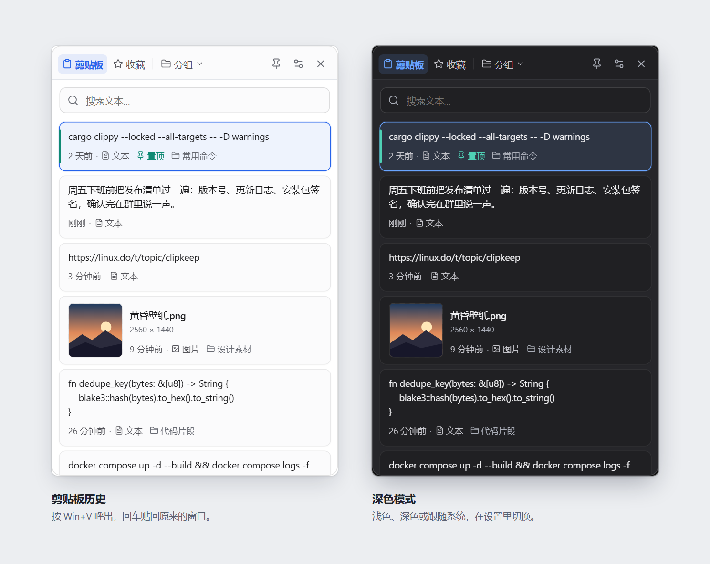
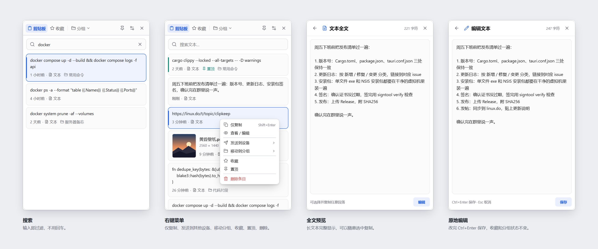
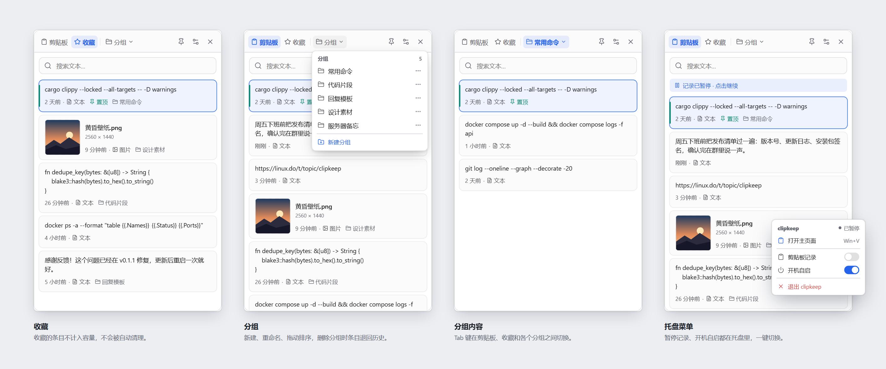
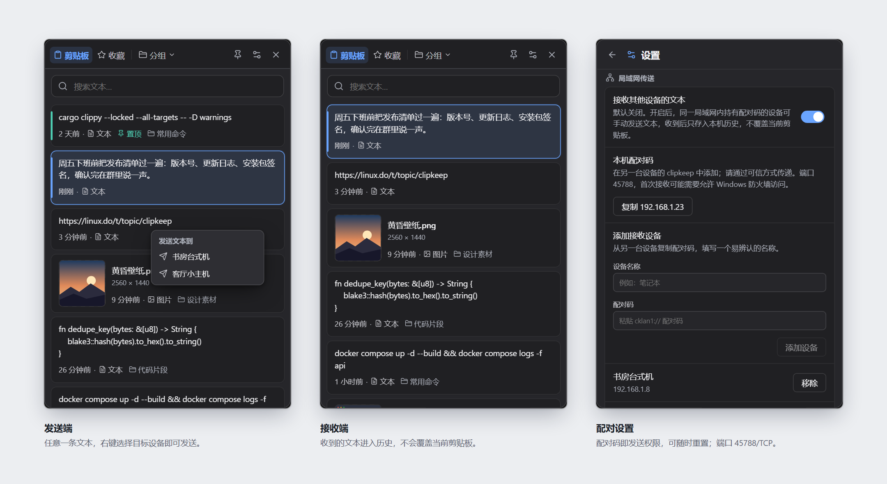
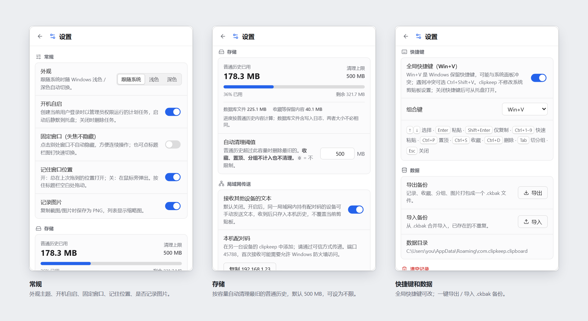

<p align="center">
  
</p>

<p align="center">
    <a href="https://linux.do" alt="LINUX DO">
        </a>
</p>

# clipkeep：一个 exe 搞定 Windows 剪贴板历史

> Rust + Tauri 2 写的，单文件 8 MB，免安装。历史不限条数，能搜能分组，还能在局域网里加密互传。MIT 开源。



---

## 为什么要再写一个

Windows 自带的 Win+V 我用了很久，问题大家应该都遇到过：

- 只存 **25 条**
- **重启就清空**
- **不能搜索**

开源的替代品我基本都试过。Ditto 和 CopyQ 很强，但界面停在十年前，设置项多到劝退；EcoPaste 和 PasteBar 界面好看了，可要装安装包，页面卡顿响应慢，也没法在两台电脑之间传东西。

我想要的其实很简单：**下载一个 exe 双击就能用，Win+V 照按，记录永远不丢，另一台电脑要用的时候直接发过去。** 找不到，就自己写了。

---

## 和主流开源方案对比

|  | **clipkeep** | Ditto | CopyQ | EcoPaste | PasteBar |
|---|---|---|---|---|---|
| **技术栈** | **Rust + Tauri 2 + Vue 3** | C++ / MFC | C++ / Qt | Rust + Tauri 2 + React | Rust + Tauri + React |
| **分发方式** | **单个 exe，8 MB** | 安装包 / 便携目录 | 安装包 / 便携目录 | 安装包 | 安装包 |
| **局域网互传** | **✅ 内置，加密直连，免账号** | 需手动配置 IP | ❌ | ❌ | ❌ |
| **界面** | **现代，跟随系统深浅色** | 老式 Win32 | Qt 传统风格 | 现代 | 现代 |
| **往管理员窗口粘贴** | **✅ 开箱即用** | 需自行提权运行 | 需自行提权运行 | 需自行提权运行 | 需自行提权运行 |
| **开源协议** | **MIT** | GPL-3.0 | GPL-3.0 | Apache-2.0 | CC BY-NC（禁止商用） |

**一句话总结：** 轻量、免安装、界面现代，同时自带局域网加密互传。目前这几样能同时满足的，只有 clipkeep。

> 实话实说：如果你需要 **跨平台**，或者要记录 **富文本和任意文件**，CopyQ 和 EcoPaste 目前做得更全。clipkeep 只做 Windows，专注把文字和图片这两样做好。

---

## 功能一览

**📋 记录**
- 历史不限条数，只按容量清理（默认 500 MB，可设为不限）
- **收藏、置顶、分组里的内容永不被自动清理**
- 文字和图片都记录，资源管理器里复制图片文件也能记下来
- blake3 哈希去重，复制同样的内容不会刷屏



**🔍 查找和整理**
- 实时搜索
- 收藏 / 置顶 / 自定义分组，分组可拖动排序
- 长文本全文预览，可以直接原地编辑



**⌨️ 键盘党友好**
- Win+V 呼出（可改），↑↓ 选择，Enter 直接粘贴回原窗口
- Ctrl+1 ~ 9 一键粘贴第 N 条
- Ctrl+P / S / D 置顶、收藏、删除，Tab 切换分组

**📡 局域网互传**
- 两台电脑配对后，任意一条文字一键发过去
- ChaCha20-Poly1305 加密，点对点直连，**不经过任何服务器**
- 对方收到的内容只进历史，不会覆盖他正在用的剪贴板



**🧩 其他**
- 浅色 / 深色 / 跟随系统三种外观，设置里一键切换
- 托盘常驻、开机自启、暂停记录
- 一键导出 / 导入备份，自动去重合并



---

## 技术栈

| 模块 | 实现 |
|---|---|
| 应用框架 | Tauri 2 · Rust 2024 edition |
| 前端 | Vue 3.5 · TypeScript 6 · Vite 8 |
| 数据存储 | SQLite（rusqlite 内置编译，WAL 模式） |
| 剪贴板 | clipboard-master 监听 + arboard 读写 |
| 全局快捷键 | windows-sys 低级键盘钩子 + SendInput 模拟粘贴 |
| 图片处理 | image crate，支持 PNG / JPEG / GIF / WebP / BMP / TIFF |
| 内容去重 | blake3 |
| 传输加密 | ChaCha20-Poly1305 |

Release 构建开了 thin LTO、`opt-level=3`、`panic=abort` 和 strip，最终产物只有一个 exe，运行时只依赖 Windows 自带的 WebView2。

CI 每次提交都会跑 `cargo fmt`、`cargo test` 和 `clippy -D warnings`。

---

## 上手

1. 从 [GitHub Releases](https://github.com/Fomovet/clipkeep/releases) 下载 `clipkeep.exe`
2. 放到任意目录，双击运行（会弹一次 UAC）
3. 按 **Win+V**，开始用

数据保存在 `%APPDATA%\com.clipkeep.clipboard\`。卸载时删掉 exe 和这个目录即可；如果开了自启，先在设置里关掉。

### 局域网互传怎么配

1. **接收方**：设置 → 局域网传送 → 打开接收 → 复制配对码
2. **发送方**：同一页面 → 添加设备 → 粘贴配对码
3. 在任意文本条目右侧点 **发送** 图标，选择设备

配对是单向的，想互发就两边各加一次。端口是 `45788/TCP`，防火墙弹窗时点允许即可。

### 从源码构建

```powershell
npm --prefix ui ci
.\ui\node_modules\.bin\tauri.cmd dev                 # 开发模式
.\ui\node_modules\.bin\tauri.cmd build --no-bundle   # 单 exe：native/target/release/clipkeep.exe
.\ui\node_modules\.bin\tauri.cmd build               # 额外生成 NSIS 安装包
```

---

## 说在前面

- 日常使用没问题，欢迎大家帮忙找 bug
- 默认以管理员身份运行，这样才能往管理员权限的窗口里粘贴
- 数据只存在本机。本地数据库和备份文件暂时没有加密，敏感内容请留意
- 少数环境下 Win+V 会被系统抢走，可以在设置里改成 Ctrl+Shift+V

有问题或想要的功能，欢迎[提 Issue](https://github.com/Fomovet/clipkeep/issues)。觉得好用的话，点个 ⭐ 就是最大的支持 🙏

## 许可证

[MIT](LICENSE)
