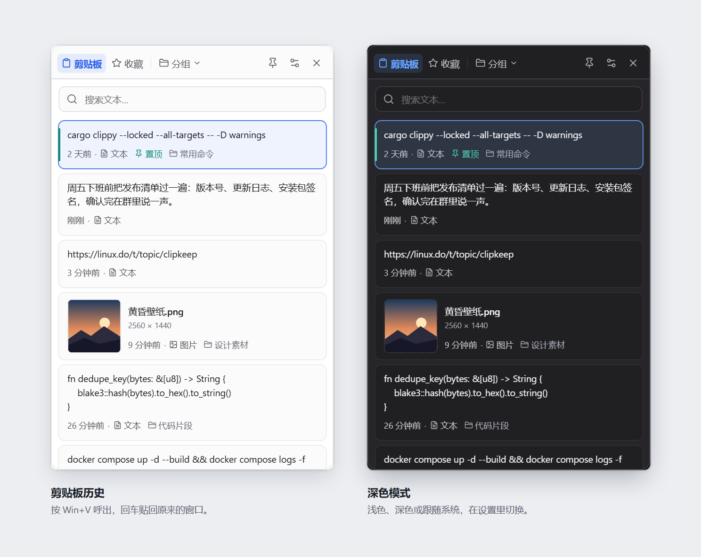

> **本仓库基于 [Fomovet/clipkeep](https://github.com/Fomovet/clipkeep) 进行二次开发。** 感谢原作者与上游贡献者提供的基础实现。本 fork 由 [BevalZ](https://github.com/BevalZ) 维护，重点扩展原生 Android 客户端、Windows/Android 加密互传，并改进存储性能、内存使用和数据可靠性。项目继续采用 [MIT 许可证](LICENSE)。

# clipkeep · Windows 与 Android 剪贴板历史

<p align="center">
  
</p>

在电脑上快速找回复制过的文字和图片，在手机与电脑之间加密发送内容。历史保存在本地，无需注册 clipkeep 账号。

[下载安装](https://github.com/BevalZ/clipkeep/releases/latest) · [更新说明](RELEASE_NOTES.md) · [Android 使用指南](android/README.md) · [反馈问题](https://github.com/BevalZ/clipkeep/issues)



截图用于展示界面布局，具体功能和样式以所安装版本为准。

## 这个 fork 提供什么

| 能力 | Windows | Android |
| --- | --- | --- |
| 本地历史 | 文本、图片、资源管理器复制的图片文件 | 文本、图片、系统分享、图片选择器 |
| 查找与整理 | 搜索、收藏、置顶、分组、全文查看与编辑 | 搜索、收藏、置顶、图片预览 |
| 跨设备传送 | 文本/图片发送与接收，可选自动发送和收到后复制 | 文本/图片发送与接收、扫描配对、连接测试、后台接收 |
| 网络 | 同一局域网或可达的私网/Tailnet IPv4，支持 MagicDNS 名称 | 同左；Wi-Fi 广播发现，Tailnet 手动指定扫描目标 |
| 容量管理 | 普通历史默认 500 MiB，可调整；收藏、置顶、分组记录不自动清理 | 普通历史默认 50 MiB；收藏和置顶不自动清理 |
| 备份与更新 | `.ckbak` 导入/导出；安装版支持应用内更新，便携版手动替换 | 正式签名 APK 覆盖升级；暂不支持桌面备份格式 |

本 fork 保留上游的桌面体验，并吸收 Windows 焦点恢复、截图兼容、安装更新和 WebView2 优化。双方的版本号分别维护，不能用数字大小判断功能是否齐全。源码差异和移植范围见 [上游对比](UPSTREAM_COMPARISON.md) 与 [移植记录](UPSTREAM_INTEGRATION.md)。

## 下载与开始使用

从 **[本 fork 的 GitHub Releases](https://github.com/BevalZ/clipkeep/releases/latest)** 下载对应文件。发布包由 GitHub Actions 构建，提供 `SHA256SUMS`；Android 另附签名校验信息。

| 文件 | 用途 |
| --- | --- |
| `clipkeep-<版本>-windows-x64-setup.exe` | Windows x64 安装版，支持安装、自启维护和应用内更新 |
| `clipkeep-<版本>-windows-x64-portable.exe` | Windows x64 单文件程序，手动下载替换；历史仍保存到用户数据目录 |
| `clipkeep-<版本>-android.apk` | Android 9 / API 28 及以上，直接安装 |
| `clipkeep-<版本>-android.aab` | 应用商店分发用 bundle，不能直接安装到手机 |

Windows 需要 WebView2 Runtime，默认请求管理员权限以支持向管理员窗口粘贴，发行包暂未做 Authenticode 签名。Android 正式版沿用本 fork 既有签名，可覆盖同签名旧版；调试包不能直接覆盖正式版。签名指纹见 [发布说明](RELEASE_NOTES.md)。

当前发布目标为 **Windows x64 和 Android**。仓库保留 Linux/macOS 桌面适配代码，尚未纳入本 fork 的正式安装包和实机验收范围。

### Windows 快捷操作

启动后使用 **Win+V** 呼出历史面板，也可点击托盘图标。快捷键可在设置中调整。

| 按键 | 操作 |
| --- | --- |
| `↑` / `↓`、`PageUp` / `PageDown` | 选择记录 |
| `Enter` | 粘贴到原输入位置 |
| `Shift+Enter` | 仅复制 |
| `Ctrl+1` ～ `Ctrl+9` | 粘贴第 1～9 条记录 |
| `Ctrl+P` / `Ctrl+S` / `Ctrl+D` | 置顶 / 收藏 / 删除 |
| `Tab` / `Shift+Tab` | 切换列表分类 |
| `Esc` | 关闭当前菜单、清空搜索或收起面板 |

固定面板支持连续粘贴并保留列表顺序。粘贴前会检查原窗口与输入控件，目标失效或焦点恢复失败时提示错误。资源管理器重命名期间，面板尽量保留原编辑框，使用鼠标点击记录粘贴。

桌面还提供浅色/深色主题、暂停记录、HEX 色值预览，以及可选的“图片粘贴时附带文件名”。图片同时提供位图与命名 PNG，便于上传页面使用原始名称。

### 手机与电脑配对

1. **接收方开启接收**：Windows 在“设置 → 局域网传送”；Android 在“设备”页开启后台接收。
2. **添加对方**：在发送方输入接收方的配对码。Android 可先“扫描响应设备”，选择设备后输入配对码，并选择建立双向配对。
3. **发送内容**：Windows 使用记录的发送按钮或右键菜单；Android 长按记录后选择发送到设备。
4. **选择复制行为**：默认收到后只存入历史。可开启“收到后复制”，再到目标应用手动粘贴；自动发送默认关闭。

配对码包含接收授权密钥，应通过可信渠道传递。设备发现只返回公开设备信息，不广播密钥。传输使用 ChaCha20-Poly1305 认证加密，应用不提供云端历史或内容中转服务。

同一 Wi-Fi 使用 UDP 广播发现；防火墙需允许 **TCP/UDP 45788**。使用 Tailscale 时，各设备需自行连接 Tailnet，并允许对应流量。Tailnet 不转发局域网广播，请在 Android 扫描框输入目标的 Tailscale IPv4 或 MagicDNS 名称；不自动枚举整个 Tailnet。VPN 是否使用中继由其自身网络决定。

传输限制为文本 **2 MiB**、PNG **8 MiB / 1600 万像素**。双方支持时使用 256 KiB 分块，完整接收和校验后才保存；支持取消，不支持断点续传。旧版文本协议仍兼容，旧客户端不因此获得图片或分块能力。完整步骤与后台运行说明见 [Android 指南](android/README.md)，格式见 [LAN_PROTOCOL.md](LAN_PROTOCOL.md)。

## 数据、性能与可靠性

- **精确去重**：文本按完整内容比较，保留空格、大小写和 Unicode 差异；合并时保留收藏/置顶等状态。图片延续各端的内容哈希规则，不做视觉相似去重。
- **数据库热点优化**：桌面用摘要索引筛选后核对正文，容量统计随事务增量维护；收藏、分组和图片引用查询有专用索引。Android 常规文本保存避免反复遍历图片目录。
- **列表与图片内存**：桌面使用虚拟列表、合并刷新和隐藏释放；Android 按需加载图片，并使用有界预览缓存。预览缩放不修改原图。
- **大备份处理**：桌面逐条解析并暂存导入内容，分批导出，减少一次加载整份历史的内存占用。
- **故障保护**：桌面损坏数据库连同日志和图片归档保留；图片入库期间受保护。容量不足、保存失败等情况返回错误，并回滚相关事务。
- **Windows 常驻优化**：热键按事件唤醒，隐藏时降低 WebView2 内存目标；托盘页面按需创建，WebView2 进程异常退出时尝试恢复。

这些优化各有取舍：索引增加磁盘空间和写入维护成本，完整子串搜索仍可能扫描正文。已有基准是 **本 fork 优化前后的局部测量**，不是与原仓库的整机性能比较，也不代表 Windows/Android 的总内存或响应时间。方法、结果和限制见 [性能基准](PERFORMANCE.md)、[内存说明](MEMORY.md) 和 [可靠性记录](RELIABILITY.md)。

### 数据位置与升级

Windows 历史、图片和设置位于 `%APPDATA%\com.clipkeep.clipboard\`，便携版也使用该目录。Android 数据保存在应用私有目录，系统云备份不包含历史和配对信息。

本 fork 与原始仓库的 Windows 应用标识相同，可能共用数据目录。切换版本前先正常退出旧实例并导出备份。当前桌面数据库为 schema 4，旧版程序会拒绝打开更高版本数据库，不能直接用原始版 exe 覆盖实现降级。

应用内更新固定指向 **BevalZ/clipkeep**。启动检查可关闭；下载和安装都由用户触发。安装前校验长度与 SHA-256，版本标签不会被重复覆盖。

## 当前限制

- Android 10+ 普通应用不能持续读取后台剪贴板。后台接收通过用户开启的前台服务运行；自动发送依赖应用前台监听或主动分享/粘贴，不是完全后台双向同步。厂商省电、Doze、强制停止或 VPN 断开仍可能中断接收。
- 暂不支持富文本、任意文件传输、IPv6、完整历史库自动同步，以及 Android 分组和 `.ckbak` 备份。接收确认不等于自动粘贴到其他应用。
- 本地数据库和备份未加密；配对码应保密。协议的跨连接防重放仍有改进空间，详情见 [对比报告](UPSTREAM_COMPARISON.md)。
- 自动化测试覆盖存储、协议和模拟 IPC，但 Windows GUI/安装升级、真实 Tailnet、多厂商后台行为仍需实际设备验证。Android 的一项生命周期时序检查仍待硬件加速模拟器或真机复核，见 [验证记录](PERFORMANCE.md)。

## 从源码构建

桌面使用 Rust stable、Node.js 24 和 Tauri 2 所需的平台依赖；前端为 Vue 3 + TypeScript + Vite，存储为 SQLite WAL。Windows 使用 WebView2。Linux 开发还需 GTK 3、WebKitGTK 4.1、AppIndicator 与 X11 开发库。

```sh
npm --prefix ui ci
cd native
# 开发模式
node ../ui/node_modules/@tauri-apps/cli/tauri.js dev
# 生产构建
node ../ui/node_modules/@tauri-apps/cli/tauri.js build -- --locked
```

桌面构建输出位于 `native/target/release/`；指定 `--target` 时位于相应目标子目录。Windows 加 `--no-bundle` 可只生成可执行文件。其他桌面平台的包格式配置见 `native/tauri.linux.conf.json` 和 `native/tauri.macos.conf.json`。

Android 需要 JDK 17/21、SDK Platform 35 和 Build Tools 35.0.0：

```sh
cd android
./gradlew :app:assembleDebug :app:testDebugUnitTest :app:lintDebug
```

构建、签名与设备测试的完整步骤见 [android/README.md](android/README.md)。

### 测试与发布

```sh
cargo test --manifest-path native/Cargo.toml --locked
cargo clippy --manifest-path native/Cargo.toml --locked --all-targets -- -D warnings
cargo test --manifest-path native/core-tests/Cargo.toml --locked
npm --prefix ui run build
```

[CI](.github/workflows/ci.yml) 检查 Windows Rust、前端构建、便携存储/协议、浏览器焦点/更新交互，以及 Android 构建、单元测试和 Lint。原生焦点验收脚本见 [native/tests](native/tests/README.md)。

[Release 工作流](.github/workflows/release.yml) 手动触发：默认只打包；开启 `publish` 后，在各端版本检查、测试、构建及 Android 签名验证通过后，创建版本 tag，上传 Windows/Android 安装文件与 SHA-256 清单，再公开 Release。签名材料来自仓库 Secrets。

## 文档与致谢

| 文档 | 内容 |
| --- | --- |
| [发布说明](RELEASE_NOTES.md) | 更新内容、安装包与签名信息 |
| [Android 指南](android/README.md) | 配对、Tailnet、后台运行、构建与测试 |
| [性能基准](PERFORMANCE.md) / [内存说明](MEMORY.md) | 优化方法、测量结果与取舍 |
| [可靠性记录](RELIABILITY.md) | 恢复归档、图片生命周期、事务和设置修复 |
| [上游对比](UPSTREAM_COMPARISON.md) / [移植记录](UPSTREAM_INTEGRATION.md) | 原始仓库差异、已移植能力及验证范围 |
| [LAN 协议](LAN_PROTOCOL.md) | 分块格式、能力协商和兼容规则 |

感谢 [Fomovet/clipkeep](https://github.com/Fomovet/clipkeep) 原作者及所有上游贡献者。本仓库保留上游许可证和版权声明，后续扩展同样以 [MIT](LICENSE) 开源。针对本 fork 的问题请提交到 [BevalZ/clipkeep Issues](https://github.com/BevalZ/clipkeep/issues)。
